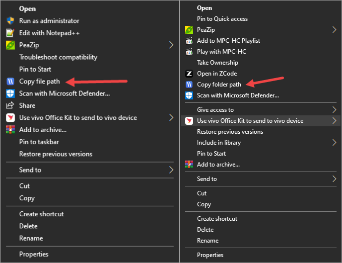
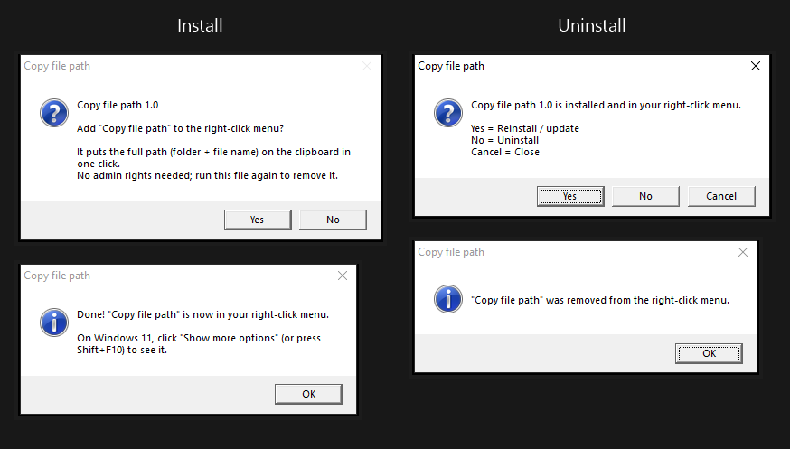

Direct download latest

Windows 10/11  :  https://github.com/finnuen/CopyFilePath/releases/latest/download/CopyFilePath.exe

# Copy file path

Adds **Copy file path** to the Windows Explorer right-click menu. One click puts the full
path (folder + file name) on the clipboard:

    E:\User\Documents\text.txt

A single `.exe` of about 1.4 MB - the right-click helper is embedded in it - with no
installer, no admin rights, nothing to install first, and nothing running in the
background.

## What it looks like

The entry sits at the top of the menu, for files and for folders:

Installing and removing it is a couple of dialogs, nothing more:

Select several items and every path lands on its own line:

    E:\User\3D Objects
    E:\User\Contacts
    E:\User\Desktop

## Use

1. Double-click `CopyFilePath.exe` and press **Yes**.
2. Right-click a file, a folder or a drive, and choose **Copy file path**.
   - Windows 11 hides new menu entries under **Show more options** (or **Shift+F10**).
3. To remove it, double-click the same file again and press **No**.

| Right-clicked | Menu entry | Copies |
| --- | --- | --- |
| a file | Copy file path | the file's path |
| a folder | Copy folder path | the folder's path |
| empty space in a folder | Copy folder path | that folder's path |
| a drive | Copy drive path | `D:\` |
| a shortcut | Copy file path | the shortcut itself (`…\thing.lnk`), not its target |
| several items | Copy file path | one path per line, in name order |

The full path is always copied, without quotes, and long paths lose the `\\?\` prefix
Explorer adds internally.

## Limits

- A selection can hold up to 100 items; Explorer stops offering the entry beyond that.
- Windows 11 keeps the entry under **Show more options**: promoting it into the main menu
  needs a packaged app, not a loose `.exe`.
- Two copies made less than a second apart are treated as one selection, because that is
  how Explorer hands the items of a single selection over - one process per item, and a
  slow one can arrive late. Wait a moment between two deliberate copies.
- The menu entry itself is a small DLL that Windows loads *inside* Explorer; the app
  writes it to `%LOCALAPPDATA%\CopyFilePath` on install. After an update Explorer keeps
  using the old copy until it restarts. Uninstalling removes everything it can at once and
  leaves a one-shot cleanup for the rest at the next sign-in, because a DLL Explorer is
  using cannot be deleted while it runs.

## Updates

The app checks GitHub on launch, and `CopyFilePath.exe check-update` does the same on
demand. Nothing is sent about you or the machine - one request for the newest release's
tag - and a failed check says nothing at all unless you asked for it. When a newer
version exists, both name it and offer the release page.

There is no self-updater: download the new `CopyFilePath.exe` (the name never changes) and
run it again; it replaces the installed copy and keeps your menu entries.

## Command line

    CopyFilePath.exe                 ask to install or uninstall
    CopyFilePath.exe install         add the menu entries
    CopyFilePath.exe uninstall       remove them
    CopyFilePath.exe copy <path>     copy a path to the clipboard (drag onto the exe)
    CopyFilePath.exe check-update    look for a newer release
    CopyFilePath.exe about           show the version
    CopyFilePath.exe selftest        run the checks; exit code 1 on failure

## Build

    build.bat

Output: `build\CopyFilePath_v<version>.exe`, printed at the end. `build.bat -KeepVersion`
rebuilds without bumping the version, `build.bat -Version 1.2` sets it. The version is two
digits: `1.0`, then `1.1`.

Needs the Rust toolchain (`cargo` and a Windows target, MSVC or MinGW) and nothing else; see `AGENTS.md`.
